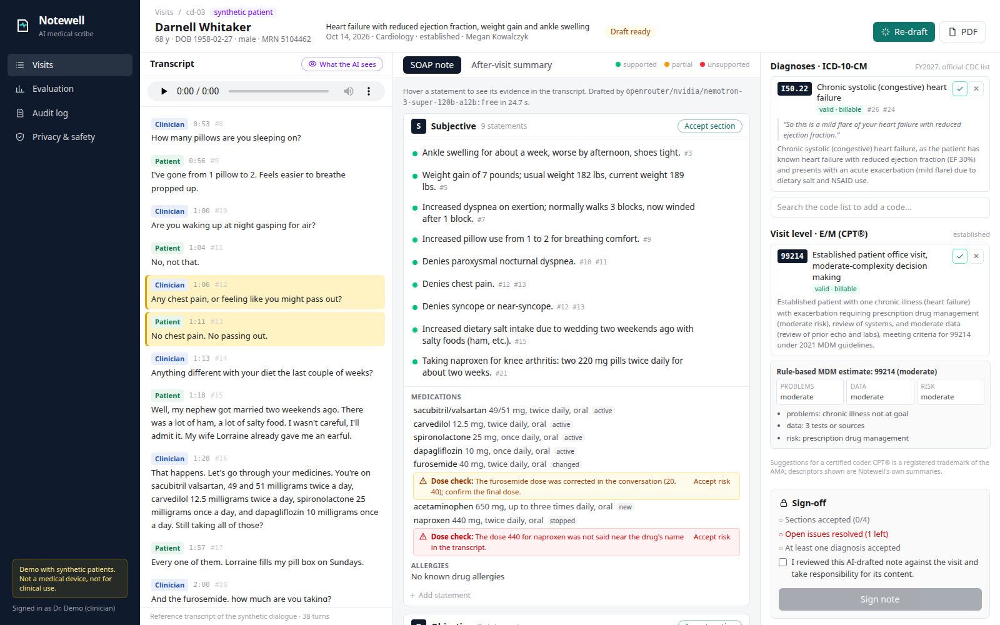

# Notewell: an AI medical scribe that turns a visit recording into a grounded SOAP note with codes

**Record or upload a clinician–patient conversation. Notewell transcribes it on the clinic's own CPU, masks every identifier before any cloud model sees the text, drafts a SOAP note, a patient-friendly after-visit summary and ICD-10-CM / E/M coding suggestions, ties every statement to a quote from the conversation, flags what it cannot back up, and waits for the clinician to review and sign. Signed notes export as FHIR R4 and PDF.**

<!-- demo-video -->

A synthetic heart-failure visit drafted by the free model `nvidia/nemotron-3-super-120b-a12b:free`. Hovering "Denies chest pain" highlights the question and the answer it came from (turns 12 and 13); the medication list shows two checks a clinician must look at (a dose corrected during the conversation, a dose nobody said); the sign-off stays disabled until every section is accepted and every issue resolved.

> **Not a medical device. Demo only, not for clinical use.** Every patient, clinician, name, number and address in this repository is synthetic. Notewell is a portfolio project that shows how such a system is built and measured; it is not cleared or approved for clinical use and it makes no claim of HIPAA compliance (see [HIPAA-minded design](#hipaa-minded-design)).

RESULTS_PLACEHOLDER
