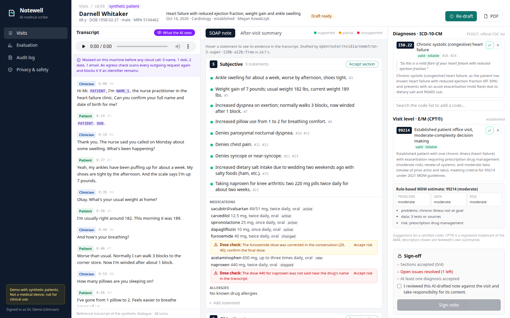
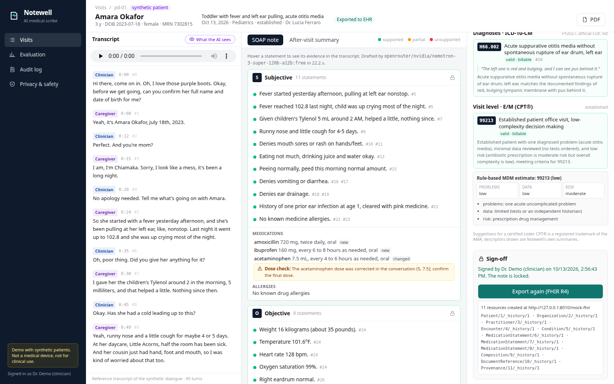
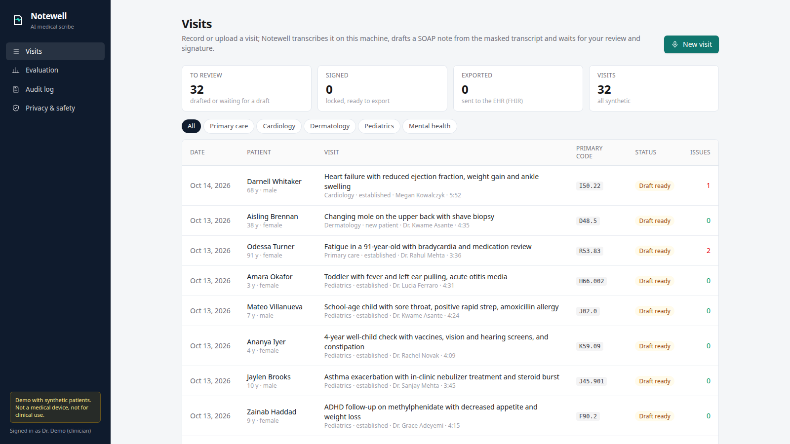
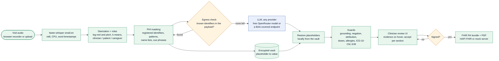
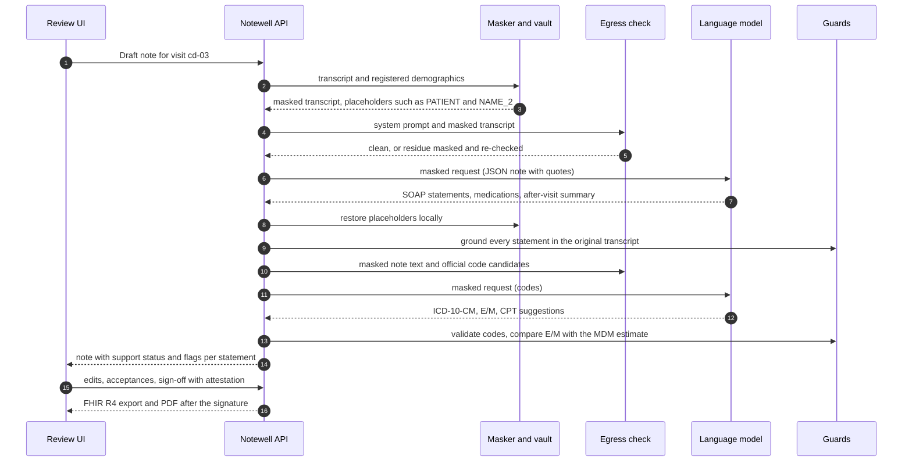
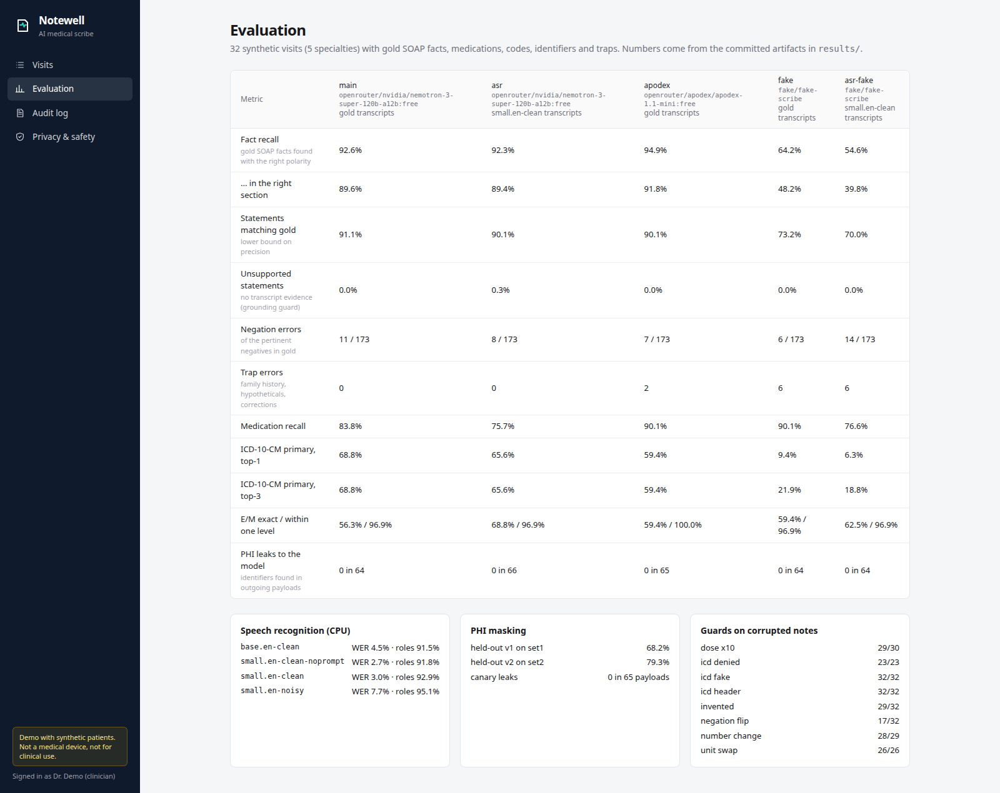

# Notewell: an AI medical scribe that turns a visit recording into a grounded SOAP note with codes

**Record or upload a clinician–patient conversation. Notewell transcribes it on the clinic's own CPU, masks every identifier before any cloud model sees the text, drafts a SOAP note, a patient-friendly after-visit summary and ICD-10-CM / E/M coding suggestions, ties every statement to a quote from the conversation, flags what it cannot back up, and waits for the clinician to review and sign. Signed notes export as FHIR R4 and PDF.**

[](https://github.com/gelevanog/ai-medical-scribe/actions/workflows/ci.yml)


<!-- demo-video -->


<sub>A synthetic heart-failure visit drafted by the free model `nvidia/nemotron-3-super-120b-a12b:free`. Hovering "Denies chest pain" highlights the question and the answer it came from (turns 12 and 13); the medication list shows two checks a clinician must look at (a dose corrected during the conversation, a dose nobody said); the sign-off stays disabled until every section is accepted and every issue resolved.</sub>

> **Not a medical device. Demo only, not for clinical use.** Every patient, clinician, name, number and address in this repository is synthetic. Notewell is a portfolio project that shows how such a system is built and measured; it is not cleared or approved for clinical use and it makes no claim of HIPAA compliance (see [HIPAA-minded design](#hipaa-minded-design)).

**Measured on 2026-10-13 and 2026-10-14** (the leak test, the main run and the audio-to-note run were repeated on 2026-10-14 with the current detector) on a 16-core laptop CPU (AMD Ryzen 9 7940HS, no GPU, shared with other jobs), on **32 synthetic visits** (5 specialties, 134 minutes of two-voice audio, 878 gold SOAP facts, 251 spoken identifiers), with the free model `nvidia/nemotron-3-super-120b-a12b:free`:

| | Result |
|---|---|
| Identifiers reaching the cloud model, in every payload of every visit (gold identifiers + canary identities) | **0** in 64 + 65 + 66 payloads (reference transcripts; the same visits with canary names, a canary contact and an injected phone and e-mail; speech-recognition transcripts) |
| PHI detection recall on **held-out** utterances written after the detector was frozen | **79%** (134 of 169 identifiers; v1 on the first held-out set: 68%); registered identifiers (name, DOB, phone, MRN) are additionally blocked by the egress check |
| Gold SOAP facts in the note, right polarity (in the right section) | **92.6%** (89.6%) of 878 facts from the reference transcripts, **92.3%** (89.4%) from the speech-recognition transcripts; rule-based extractive baseline: 64.2% |
| Note lines an independent reviewer found not supported by the conversation | **0.4%** (1 contradicted, 0 invented, 9 with a minor inaccuracy, of 275 lines in 8 visits) |
| The guards on 236 deliberately corrupted notes (changed numbers, ×10 doses, swapped units, invented lines, fake / non-billable / denied codes, flipped negations) | **216 caught (92%)**: 96-100% for numbers, doses, units and codes, 91% for invented lines, **53% for flipped negations** (47% before two concepts seen in the misses were added) |
| ICD-10-CM primary code: top-1 exact / within the gold's acceptable alternatives / right category | **69%** / 84% / 84% (only billable, existing codes reach the clinician) |
| E/M level: model exact / within one level / deterministic MDM estimate exact | 56% / **97%** / 69% |
| Speech recognition (faster-whisper `small.en`, CPU), WER clean / noisy (15 dB) | **3.0% / 7.7%**; drug names and numbers recognized: 89.8% |
| Speaker roles right (word level), different-sex / same-sex voice pairs | 92.9% overall: **98.1% / 78.8%** |
| Time per visit on CPU (4.2-minute visit, median) | ASR **37.6 s** + masking 0.04 s + model 25 s (free tier, p95 40 s) + guards 0.1 s |
| Cost | **$0**: 401 requests to free models (291 answered; the rest were rate limits and provider refusals, retried or given up), every requested and served model id ending in `:free` ([ledger](results/calls.jsonl)); about 5,100 input and 2,900 output tokens per visit |

**The honest verdict:** the parts that are code do what they claim on this data: no identifier reached a model, every suggested code that reaches the clinician exists and is billable, doses and numbers that nobody said are caught almost every time, and nothing is signed without a human. The free model writes good notes: 92.6% of the gold facts from the reference text and 92.3% from the CPU speech-recognition transcripts, and a reviewer found one contradicted line in 275. The weak spots are measured and visible: the negation guard only knows the findings in its lexicon, so it caught about half of the flipped negations (the one real negation error in the audit, "denies dizziness" for a patient whose room "swims", was caught only after the lexicon learned lay words for dizziness); PHI detection of identifiers the clinic did not register is 79% on unseen phrasing, so the egress check on registered identifiers is the hard guarantee, not the detector (the first run on speech-recognition transcripts found two lowercase organization names the detector missed; fixed, and all leak checks were repeated with the fix); free-model coding picks the right primary ICD-10-CM code 69% of the time and misses preventive-visit Z codes; and the small diarizer is reliable only when the two voices differ in pitch. A stronger model, a real diarization model and real recordings are the next steps (see [Roadmap](#roadmap)). Details, failures and every number's source are below.

## What problem it solves

Clinicians spend about as long documenting as they spend with patients. Ambient AI scribes (record the visit, get a draft note) are one of the fastest-growing categories in health tech, and clinics, telehealth startups and EHR vendors want one of their own. The hard part is not getting a language model to write a plausible note; it is everything around it:

- **Privacy.** A visit recording is full of protected health information. Sending it to a cloud model without a Business Associate Agreement is a HIPAA problem; even with one, the less identifiable data leaves the building, the better.
- **Trust.** A note that is fluent but wrong is worse than no note: a symptom the patient denied becomes "reports chest pain", the father's heart attack becomes the patient's, "10 milligrams, no wait, 20" becomes 10. The clinician has to see, for every sentence, where it came from.
- **Coding.** A suggested ICD-10-CM code must exist, be billable and be supported by what was said; the E/M level must follow medical decision making.
- **Workflow.** Nothing is final until a clinician has reviewed and signed it, and the result must land in the EHR in a standard format (FHIR).

Notewell is a complete, measured implementation of that pipeline on synthetic data: the parts that must be deterministic (masking, the egress check, grounding, negation, dose and code checks, the sign-off gate, FHIR) are code, and the model is a swappable component.

## Features

- **Speech on the clinic's CPU.** faster-whisper (`small.en`, int8) with word timestamps and a short medication-name prompt; no audio leaves the machine. A small two-speaker **diarizer** (log-mel and pitch signatures, k-means, lexical role inference) labels each turn clinician, patient or caregiver. Record in the browser (MediaRecorder) or upload a file; uploads are stored AES-GCM encrypted.
- **PHI masking before any cloud call** (implemented in this repository, independently of the sibling project [PII Shield](https://github.com/gelevanog/pii-redaction-gateway)):
  - registered identifiers from the schedule (name, date of birth, phone, MRN, address, e-mail), matched exactly and fuzzily (speech recognition writes "Ferreira" as "Ferrera");
  - patterns for the HIPAA Safe Harbor identifiers that occur in conversations: phones (also read digit by digit), e-mails and portal URLs spoken aloud ("j underscore reyes at proton mail dot com"), member IDs spelled with the NATO alphabet, SSNs, dates (spoken, numeric, holidays, months tied to events), ages over 89 ("ninety-three"), street addresses, units, ZIP codes, towns (US Census gazetteer), employers and schools;
  - names from titles, cue phrases ("my daughter Priya", "this is", "call me"), spelled-out names ("N-G-U-Y-E-N"), lowercase ASR names ("doctor kowalski"), US Census name lists plus an international list, and unknown capitalized words in mid-sentence;
  - stable placeholders per visit (`[PATIENT]`, `[DOB]`, `[NAME_2]`, `[PHONE_1]` ...), linked across partial mentions ("Marisol", "Mrs. Ferreira"), restored locally from an encrypted vault.
- **Egress check, fail closed.** Every outgoing request (system prompt included) is scanned again for every value the vault holds and every registered identifier, as text, as digit runs with any separators and as close misspellings. A hit is masked and re-checked; if anything remains, the request is not sent. The ledger stores a hash of each payload, never the payload.
- **Drafting.** The model returns JSON: SOAP statements, each with turn numbers and a verbatim quote, medications with dose/frequency/route/status, allergies, and a 6th-grade after-visit summary. A second call suggests ICD-10-CM codes (with candidates retrieved by BM25 from the official code list), the E/M level and CPT procedures. Malformed JSON gets a local bracket repair and one corrective retry.
- **Guards, all deterministic:**
  - **grounding**: quotes must occur in the cited turn (or another one, which then replaces the citation); numbers and drug names in a statement must have been said near the evidence; statements without support are linked to the best turn or flagged *unsupported*;
  - **negation and attribution**: a NegEx-style scope check plus the question-and-answer rule ("Any chest pain?" "No." means denied); flags "reports X" when the transcript only denies X, "denies X" when X was described, a family member's or another person's condition stated as the patient's, and hypotheticals ("if the rash spreads...") stated as findings;
  - **medications** against a small open drug list (177 entries, FDA-label orientation ranges): unknown drugs, impossible units (levothyroxine in mg), per-dose and daily maximums, pediatric mg/kg/day, doses nobody said, doses corrected during the conversation, allergy and cross-reactivity conflicts;
  - **codes**: valid and billable in the FY2027 ICD-10-CM list (category headers come back with their billable children), evidence quote, consistency with the assessment, no code for a finding the patient denied; E/M family matches new/established, and the level is compared with a **rule-based 2021 MDM estimate** (problems, data, risk); CPT procedures only from an allowed list with evidence that they happened today;
  - **after-visit summary**: reading level, and no number or drug that is not in the note.
- **Clinician review UI** (Next.js + Tailwind): visit list, new visit with recorder, transcript with speaker roles and audio seek, the note editor (edit, add, remove, accept per section), evidence highlighted in the transcript on hover, a "What the AI sees" toggle that shows the masked transcript, a codes panel (accept/reject, search the official list to add a code, the MDM breakdown), and a sign-off that requires every section accepted, every error resolved or explicitly acknowledged, a diagnosis accepted and an attestation.
- **Export.** A FHIR R4 transaction Bundle (Patient, Practitioner, Organization, Encounter, Composition with the SOAP sections, DocumentReference with the PDF and text, Condition per accepted ICD-10-CM code, MedicationStatement, AllergyIntolerance, Provenance recording AI drafting and clinician signature), validated locally with `fhir.resources` and checked against a real **HAPI FHIR 8.12** server; a built-in mock FHIR server for the demo; a PDF of the signed note.
- **Audit log and encryption at rest**: every view of masked data, draft, edit, acceptance, signature and export is logged with actor and time, without identifiers or clinical text; visit documents, vaults and uploads are AES-256-GCM encrypted in SQLite.
- **MCP server** for Claude Code and Claude Desktop with PHI masking enforced server-side (see [below](#use-with-claude-code-and-claude-desktop)).
- **Providers**: `fake` (an offline rule-based extractive scribe, so tests, CI and the demo need no key; also the evaluation's baseline), `openrouter` with a **free-only guard** (refuses ids without `:free`, `:online` variants, plugins, and answers served by a paid model), and `openai_compatible` (any endpoint, for example a BAA-covered gateway) behind an explicit `NOTEWELL_ALLOW_PAID_MODELS=true`. Real calls go through retries with backoff, a throttle, a disk cache, a hard call budget and a JSONL call ledger.

| What the AI sees | Signed and exported |
|---|---|
|  |  |
| The "What the AI sees" toggle shows the masked transcript, exactly what the model receives, with the counts of masked identifiers. | A signed note is locked; the export creates Patient, Encounter, Composition, DocumentReference, Condition, MedicationStatement, AllergyIntolerance and Provenance resources. |



## How it works

**The pipeline.** Everything left of the dashed line runs on the clinic's machine; only masked text crosses it.



**One draft, step by step.** Two model calls per visit: the note, then the codes. The second call carries the note text, which is masked again first.



## Evaluation

Every number has a committed artifact in [`results/`](results); `make eval-offline eval-asr eval-real report` reproduces them (the real-model runs use the disk cache, so a re-run costs no new requests). [`results/report.md`](results/report.md) is generated from the same files, and the UI's *Evaluation* page renders them.



### The dataset

32 visits in [`data/visits/`](data/visits): primary care (8: hypertension with a dose correction, diabetes, sinusitis, low back strain, a wellness visit with a flu shot and smoking counseling, cystitis with a urine dip, a new patient with Hashimoto's and hyperlipidemia, a 91-year-old with bradycardia), cardiology (6), dermatology (6: biopsy, acne, eczema, warts, psoriasis, actinic keratoses), pediatrics (6, five with a parent as the second speaker, weight-based dosing) and mental health (6: depression with a safety screen, anxiety, a therapy intake, bipolar II, insomnia, alcohol use). 1,196 turns, 20,700 words. Each file holds the dialogue and its gold annotations: 878 atomic SOAP facts (173 pertinent negatives) with a verbatim evidence quote and keyword groups for scoring, 111 medications, 71 ICD-10-CM codes (with acceptable alternatives), the E/M code with its MDM rationale, CPT procedures, 251 spoken identifiers, and 91 traps (family history, hypotheticals, other people, resolved problems, corrections, small talk). `notewell data validate` checks every quote, identifier and code against the official list.

The dialogues and annotations were written by AI agents (Claude) for this repository, one agent per specialty, against a written brief, and validated by script. They are realistic but they are not real visits: speech is cleaner, nobody interrupts, and the gold facts reflect one annotator's view. Treat the numbers as a regression benchmark for this system, not as a clinical accuracy claim.

The audio was synthesized with Kokoro-82M on CPU (44 minutes for 134 minutes of audio), two different voices per visit from a pool of 12 (24 visits with a female and a male voice, 8 with two voices of the same sex), 0.25-0.75 s between turns, and a second copy with pink noise at 15 dB SNR.

### Notes and codes

Notes drafted from the reference transcripts, two requests per visit (note, then codes), scored against the gold annotations ([`results/runs/*/summary.json`](results/runs), per-visit notes and scores in `results/runs/*/notes/`):

| Run | `nemotron-3-super-120b-a12b:free` | same model, **from ASR transcripts** | `apodex-1.1-mini:free` | Rule-based baseline (`fake`) |
|---|---|---|---|---|
| Fact recall, right polarity (right section) | **92.6%** (89.6%) | **92.3%** (89.4%) | **94.9%** (91.8%) | 64.2% (47.8%) |
| Statements matching a gold fact (lower bound on precision) | 91.1% of 941 | 90.1% of 948 | 90.1% of 896 | 72.9% of 669 |
| Statements flagged by the grounding guard: unsupported / partly supported | 0% / 1.8% | 0.3% / 9.0% | 0% / 1.9% | 0% / 0.3% |
| Negation errors flagged by the scorer (of 173 pertinent negatives) | 11 (1 real on review, see below) | 8 | 7 | 6 |
| Trap errors (family history, hypotheticals, ... stated as the patient's) | **0** of 91 | **0** | 2 | 6 |
| Medications found / dose right | 83.8% / 70.3% of 111 | 75.7% / 59.5% | 90.1% / 73.9% | 90.1% / 57.7% |
| ICD-10-CM primary: top-1 = top-3 / alternatives / category | **68.8%** / 81.3% / 84.4% | 65.6% / 78.1% / 84.4% | 59.4% / 75.0% / 84.4% | 9.4% (top-3 21.9%) |
| All gold diagnoses suggested | 62.0% | 60.4% | 63.0% | 21.4% |
| E/M exact / within one level | 56.3% / 96.9% | 68.8% / 96.9% | 59.4% / 100% | 59.4% / 96.9% |
| Deterministic MDM estimate exact (same notes) | **68.8%** | 68.8% | 65.6% | 53.1% |
| CPT procedures found | 78.3% of 23 | 69.6% | 69.6% | 47.8% |
| Identifiers in the payloads | **0** of 64 | **0** of 66 | **0** of 65 | 0 of 64 |
| Model time per visit, p50 / p95 | 24.9 s / 40.4 s | 28.5 s / 45.9 s | 20.9 s / 39.0 s | 0.2 s |

How the facts are scored: a gold fact counts as found when one note line contains every keyword group of the fact (any synonym) with the same polarity, judged by a NegEx-style scope check. The scorer is lenient about wording and strict about polarity; it misreads some lines, which is why the negation errors were reviewed by hand. Of the 11 the scorer flagged for the main run, **one is a real negation error** (pc-08: "Denies dizziness upon standing"; the patient said the room "kind of swims" when she gets out of bed). The others are scorer artifacts: a post-negation it missed ("radiates to the left arm, not to the jaw"), gold facts that are negative findings labelled present ("straight leg raise negative"), and keyword collisions ("fall asleep" for "no fall").

**The independent audit.** A separate AI agent (Claude), given only the transcripts and the note lines of 8 visits (one to two per specialty, 275 lines), labelled every line as supported, minor inaccuracy, unsupported or contradicted ([`results/audit/labels.json`](results/audit/labels.json)): 265 supported, 9 minor (an added "D3" for "vitamin D", "sinus" bradycardia never said, two items merged, a status "active" for a dose changed today), **0 unsupported, 1 contradicted** (the dizziness above). Compared with the guards ([`audit_vs_guards.json`](results/audit/audit_vs_guards.json)): the contradicted line is flagged as a negation conflict (after the lexicon learned lay words for dizziness, which I added after reading this error, so it is not an independent result), the 9 minor issues are not flagged, and 4 correct lines carry a "partly supported" warning (1.5% false alarms).

**Coding.** The model suggests few codes (1-3), so top-3 equals top-1. The misses are mostly specificity and visit-type questions a coder would argue about: I50.22 (chronic) instead of I50.23 (acute on chronic) for a heart-failure flare, S93.412A (anterior talofibular ligament) instead of the gold's unspecified S93.401A, the problem coded instead of the preventive-visit Z codes (Z00.00, Z00.121), E03.3 instead of Hashimoto's E06.3. One invalid code was suggested and stopped by the guard. The deterministic MDM estimate matches the gold E/M level more often (69%) than the model does (56%); disagreements are shown to the clinician with the reasons.

### PHI masking and the leak test

| | Result |
|---|---|
| Identifiers in outgoing payloads, main run (64 payloads, gold identifiers + registration) | **0** |
| Canary run: each visit's patient renamed to a canary identity (name, MRN) plus an injected unregistered contact (a relative's full name, a phone number, a spoken e-mail), 7 canary values per visit, 65 payloads | **0 leaks** ([`canary.json`](results/canary/canary.json)), repeated with the current detector |
| Dialogues, gold identifiers covered (development set, the detector was tuned on it) | 99.6% of 251 |
| The same identifiers in the `small.en` transcripts (where recognition kept them recognizable) | 99.4% of 159 |
| **Held-out set 1** (100 utterances, 148 identifiers, written by a separate agent before it was seen), detector v1 frozen | 68.2% ([`challenge_v1_frozen.json`](results/phi/challenge_v1_frozen.json)) |
| **Held-out set 2** (120 utterances, 169 identifiers, written after v2 was frozen), detector v2 | **79.3%** ([`challenge2_v2_frozen.json`](results/phi/challenge2_v2_frozen.json)); 22 of 25 clean utterances left untouched |
| Masked words that were not identifiers (dialogues) | 5.1% (mostly month names near events, which Safe Harbor treats as date elements) |

The detector was improved once between the two held-out sets (v1 to v2: spelled-out names, lowercase ASR names, spoken URLs, holidays, ages in words, units, ZIP codes, a town gazetteer); set 1 was used for that and is no longer held out (96% now). On set 2, the misses are names that are ordinary words without a cue ("Royal and I got married young", "Christian and Faith"), a lone surname at the start of a sentence ("Henderson covered my shift"), dates and dates of birth read as bare numbers ("11 23 57", "3, 15, 1958"), phone numbers in words ("five five five, oh one nine two"), and IDs with letters spaced out. That is why the design does not rely on the detector alone: identifiers the clinic registered (name, DOB, phone, MRN, address, e-mail) are checked again in every payload by the egress check, including their misspellings, and a hit blocks the request.

### Speech recognition and diarization

faster-whisper int8 on CPU on the synthetic audio ([`results/asr/`](results/asr)); WER after a normalizer that treats "two weeks" and "2 weeks", "152/94" and "152 over 94" alike; key terms = drug names and numbers of the gold text recognized exactly (after the drug-name correction step); roles = words attributed to the right speaker.

| Model and condition | Visits | WER | Drug names and numbers | Speaker roles | ASR s per visit (p50) | Real-time factor |
|---|---|---|---|---|---|---|
| `small.en`, clean, medical prompt (used) | 32 visits | 3.0% | 89.8% | 92.9% | 37.6 | 0.14 |
| same, on the 12-visit subset | 12 | 2.7% | 89.8% | 91.8% | - | - |
| `small.en`, pink noise 15 dB | 12 | 7.7% | 87.6% | 95.1% | 41.0 | 0.17 |
| `base.en`, clean | 12 | 4.5% | 84.8% | 91.5% | 15.2 | 0.058 |
| `small.en`, clean, no prompt | 12 | 2.7% | 90.2% | 91.8% | 39.3 | 0.148 |

Word-level speaker roles: **98.1%** on the 24 visits with a female and a male voice, **78.8%** on the 8 with two voices of the same sex (pd-01 and pd-03, two female voices, are mostly swapped: the voice clusters do not separate and the clinician cluster is chosen wrongly). The diarizer fits two voice centers (40 log-mel bands and pitch) on pause-separated chunks and labels each word with a Viterbi pass that makes speaker changes cheap at sentence ends; an earlier chunk-level version scored 81.6% overall, because Whisper glues the start of an answer to the end of a question. Most remaining recognition errors are rare drug names spoken by a TTS voice (`apixaban`, `lamotrigine`, `succinate`); a post-ASR correction maps near-misses to the drug list ("adorvastatin" to atorvastatin), which raised the key-term recall from 86.2% to 89.8%. The medical prompt changes little on clean audio; pink noise at 15 dB nearly triples the WER.

**From audio to note.** The same model drafted notes from these `small.en` transcripts (diarized, with recognition errors) instead of the reference text ([`results/runs/asr`](results/runs/asr/summary.json), the second column of the notes table): fact recall barely moves (92.3% vs 92.6%); what suffers is the structured detail: medications found 75.7% vs 83.8%, correct doses 59.5% vs 70.3%, and 9% of statements carry a partly-supported warning because a misheard number or drug name no longer matches the quote. One statement had no support at all. The egress check masked one residual name (a speech-recognition spelling of a registered name that the detector missed) before sending; no identifier left the machine. The first attempt at this run (2026-10-13) was refused by OpenRouter's daily free-model limit; its 429 responses are in the ledger as `retryable_error`. The offline baseline on the same transcripts ([`results/runs/asr-fake`](results/runs/asr-fake/summary.json)) found a real privacy gap first: Whisper writes unknown organization names in lowercase ("at her daycare, little acorns,", "Harbor point distribution, I'm a shift lead"), which the detector missed (2 identifiers in 64 payloads). The detector now handles appositions after daycare/school/work and business suffixes in any case; every leak check above was repeated with the fix.

### Guards on corrupted notes

[`results/guards.json`](results/guards.json): each corruption applied to a copy of a real drafted note, then the guards re-run; caught = a new error-level flag of the expected kind on the corrupted item.

| Corruption | Trials | Caught |
|---|---|---|
| a number in an objective statement changed (152 to 182) | 29 | 96.6% |
| a medication dose multiplied by 10 | 30 | 96.7% |
| a dose unit swapped (mg and mcg) | 26 | 100% |
| an objective or assessment line copied from a visit of another specialty | 32 | 90.6% |
| a non-billable category instead of the code / an invented code / a code for a symptom the patient denied | 32 / 32 / 23 | 100% / 100% / 100% |
| "Denies X" flipped to "Reports X" | 32 | **53.1%** (46.9% before adding two concepts seen in the misses) |

The negation guard needs the finding to be in its lexicon (94 concepts with lay synonyms); a flip of "no oozing or crusting" or "warts don't hurt" goes unnoticed. Missed invented lines are generic ones that happen to be true in the other visit too ("Lungs clear").

### Latency and cost

Per visit, on the shared laptop CPU: speech recognition 37.6 s (median, `small.en`, real-time factor 0.14), diarization 1.3 s, masking 0.04 s, the free model 19.9 s for the note and 4.2 s for the codes (median; p95 37 s and 8.7 s, free-tier queueing included), guards 0.1 s. End to end about 64 s for a 4-minute visit. Notes take about 5,100 input and 2,900 output tokens per visit. All 401 requests ([ledger](results/calls.jsonl), [summary](results/calls_summary.json), `uv run notewell calls`) went to `:free` models: the smoke test of 8 candidates, development runs, the main and comparison runs, the ASR-transcript run and the canary run; $0.

**How the model was chosen** ([`results/smoke.json`](results/smoke.json)): eight free models drafted one visit. `nemotron-3-super-120b-a12b` with hidden reasoning disabled (with reasoning on it spent all 8,000 output tokens thinking and returned nothing) was fast (22 s) and complete; `nemotron-3-ultra-550b` and `dots-3-note-preview` were slower, `laguna-s-2.1` took 74 s, `nemotron-3.5-lightning` returned malformed JSON twice, both Gemma 4 models were rate-limited, and `inkling` refused API use ("only available on agentic harnesses").

## Quick start

**1. Offline, no keys, no downloads.** The visit list is seeded with the 32 synthetic visits and the notes the free model drafted in the evaluation; the `fake` provider (a rule-based extractive scribe) drafts new ones.

```bash
uv sync                      # Python 3.12
make serve                   # API on http://localhost:8000 (mock FHIR server at /mock-fhir)
cd web && npm ci && npm run dev   # review UI on http://localhost:3000
make test                    # the test suite, no keys, no downloads
```

```bash
uv run notewell draft pc-01  # draft a visit in the terminal, with flags
uv run notewell mask cd-03   # exactly what a cloud model would receive
```

**2. With a free model** (the free-only guard is on by default):

```bash
export OPENROUTER_API_KEY=sk-or-...
NOTEWELL_LLM_PROVIDER=openrouter NOTEWELL_LLM_MODEL=nvidia/nemotron-3-super-120b-a12b:free make serve
```

For a production-like setup use an OpenAI-compatible endpoint covered by a BAA: `NOTEWELL_LLM_PROVIDER=openai_compatible NOTEWELL_LLM_BASE_URL=... NOTEWELL_ALLOW_PAID_MODELS=true`.

**3. Local speech** (faster-whisper on CPU; Kokoro only to synthesize the evaluation audio):

```bash
uv sync --extra speech
make models                  # faster-whisper small.en / base.en, Kokoro-82M (~0.9 GB, once)
make audio                   # speak the 32 visits with two voices (clean + noisy WAV)
NOTEWELL_STT_PROVIDER=whisper make serve   # record or upload a visit in the UI
```

**4. The full code list and the evaluation:**

```bash
make codes                   # official ICD-10-CM FY2027 from CDC, SHA-256 verified
make eval-offline            # fake-model baseline + PHI detection (no API calls)
make eval-asr                # WER, key terms, diarization on the synthetic audio (CPU)
make eval-real               # notes, ASR-to-note, canary leak test with free models
make report                  # results/summary.json, results/report.md, ledger summary
```

**Docker:**

```bash
docker compose up --build                     # UI :3000, API :8000 with the mock FHIR server
docker compose --profile hapi up --build      # plus HAPI FHIR R4 on :8080 (set NOTEWELL_FHIR_BASE_URL=http://hapi:8080/fhir)
```

## Configuration

Environment variables with the `NOTEWELL_` prefix; [`.env.example`](.env.example) lists them all.

| Variable | Default | Purpose |
|---|---|---|
| `NOTEWELL_LLM_PROVIDER` / `_LLM_MODEL` / `_LLM_FALLBACK_MODELS` | `fake` / provider default / none | `fake`, `openrouter`, `openai_compatible`; model id; fallbacks |
| `OPENROUTER_API_KEY`, `NOTEWELL_LLM_BASE_URL` / `_LLM_API_KEY` | unset | credentials (never logged; the ledger holds no prompts) |
| `NOTEWELL_REQUIRE_FREE_MODELS` / `_ALLOW_PAID_MODELS` | `true` / `false` | free-only guard; explicit opt-in for anything metered |
| `NOTEWELL_LLM_REASONING_EFFORT` | `none` | sent to OpenRouter; free reasoning models otherwise spend the whole budget thinking |
| `NOTEWELL_LLM_MAX_CALLS` / `_MAX_RETRIES` / `_CACHE` / `_LEDGER` | `800` / `4` / `false` / `results/calls.jsonl` | call budget, retries, disk cache (on in `eval`), ledger |
| `NOTEWELL_BLOCK_ON_PHI` | `true` | fail closed when the egress check cannot clean a payload |
| `NOTEWELL_CODE_CANDIDATES` | `25` | ICD-10-CM candidates retrieved from the official list for the coding prompt |
| `NOTEWELL_STT_PROVIDER` / `_STT_MODEL` / `_STT_THREADS` / `_STT_MEDICAL_PROMPT` | `fake` / `small.en` / `4` / `true` | `whisper` for faster-whisper on CPU |
| `NOTEWELL_DATA_DIR` / `_DATA_KEY` / `_RETENTION_DAYS` | `var` / generated / `30` | encrypted store, AES-256 key (base64), retention for `notewell purge` |
| `NOTEWELL_AUTH_TOKENS` | empty (demo mode) | `role:name:token,...`; only `clinician` may edit, sign, export |
| `NOTEWELL_FHIR_BASE_URL` | `http://127.0.0.1:8000/mock-fhir` | the mock server or a HAPI FHIR `/fhir` base |
| `NOTEWELL_CORS_ORIGINS` | `http://localhost:3000` | the review UI's origin |

| Endpoint | Description |
|---|---|
| `GET /api/visits`, `POST /api/visits`, `GET /api/visits/{id}` | visit list, create (registration data), detail |
| `POST /api/visits/{id}/audio`, `GET .../audio`, `POST .../transcribe` | encrypted upload, playback, local transcription |
| `GET /api/visits/{id}/masked` | the masked transcript (what a model sees) |
| `POST .../draft`, `PUT/DELETE/POST .../statements`, `POST .../acknowledge`, `POST .../sections/{s}/accept` | draft and review |
| `POST .../codes`, `POST .../codes/add`, `GET /api/codes/search` | accept or reject codes, add from the official list |
| `POST .../sign`, `POST .../export/fhir`, `GET .../fhir`, `GET .../note.pdf` | sign-off, FHIR export and preview, PDF |
| `GET /api/audit`, `GET /api/eval`, `GET /health`, `/mock-fhir/...` | audit log, evaluation summary, health, mock FHIR server |

## Use with Claude Code and Claude Desktop

`notewell mcp` runs an MCP server (Python SDK `mcp==2.3.0`, stdio or Streamable HTTP) with the scribe's tools. The MCP client is itself a cloud model, so the server enforces the same boundary as the pipeline: **every string a tool returns is masked** (the visit's vault, the detector, then the egress check), and placeholders are only restored inside Notewell. Signing is deliberately not a tool.

| Tool | What it does |
|---|---|
| `list_visits` | visits with specialty, status; patients shown as `[PATIENT]` |
| `transcribe_visit` / `get_transcript` | local transcription (or the reference transcript), returned masked with speaker roles |
| `draft_note` | Notewell's own pipeline with its configured model; masked note with support status and flags per statement |
| `check_note` | verify statements *Claude* wrote from the masked transcript: grounding, negation, attribution, hypotheticals |
| `suggest_codes`, `validate_codes`, `search_icd10` | ICD-10-CM against the official FY2027 list, E/M with the MDM estimate, CPT |
| `export_fhir` | post a clinician-signed note to the FHIR server; refused before the signature |

Claude Code: copy [`.mcp.json.example`](.mcp.json.example) to `.mcp.json` in this directory (or `claude mcp add notewell -- uv run --directory /path/to/ai-medical-scribe notewell mcp`). Claude Desktop: add the same command to `claude_desktop_config.json` under `mcpServers`. Then ask, for example: *"List the cardiology visits, write a SOAP note for cd-03 from the masked transcript, check it with check_note and fix what it flags, then suggest codes."* The tools were exercised through the server's tool layer in the tests (`tests/test_fhir_mcp.py`), not inside a live Claude Desktop session.

## HIPAA-minded design

This is a demo, not a compliant system. What it does, and what a real deployment still needs:

| Area | In this repository | Before real patient data |
|---|---|---|
| Vendors | free OpenRouter models on **synthetic** data only; free endpoints may log prompts, which is why masking is the default path | a **Business Associate Agreement** with every vendor touching PHI (LLM provider, hosting, speech if not local); a BAA-covered model endpoint |
| Minimum necessary | identifiers masked before any model call; the egress check fails closed; the MCP server returns masked data only | masking is defense in depth, not a de-identification certification; review what the model may see |
| Encryption | AES-256-GCM at rest for visits, vaults, uploads (record-bound); key from env or a local key file | keys in a KMS/HSM, TLS everywhere, encrypted backups |
| Access control | bearer tokens with roles; only clinicians edit, sign, export | SSO/MFA, per-patient authorization, session management, break-glass |
| Audit | every view of masked data, draft, edit, acceptance, signature, export; no identifiers or clinical text in the log | tamper-evident storage, retention per policy, regular review |
| Retention | `notewell purge`: audio and vaults of signed visits deleted after `NOTEWELL_RETENTION_DAYS` | documented policy, patient consent for recording, deletion requests |
| Safety | grounding, negation, dose and code guards; no note leaves without a clinician's signature | clinical validation with real clinicians, monitoring, incident process, regulatory assessment (FDA CDS guidance) |

## Project structure

```text
src/notewell/
├── phi/            # detector (registered identifiers, patterns, name lists, cues), masker + vault, egress check, gazetteers
├── llm/            # OpenRouter / OpenAI-compatible client, free-only guard, retries + cache + budget + ledger, fake scribe
├── scribe/         # prompts, tolerant JSON parsing and repair, the pipeline (mask, egress, draft, restore, guard)
├── guards/         # grounding, negation and attribution, medications, ICD-10-CM / E/M / CPT, after-visit summary
├── codes/          # official ICD-10-CM list (download, subset, BM25 search, validation), rule-based E/M (MDM)
├── kb/             # drug list (177), clinical concepts (94), CPT list with Notewell's own descriptors
├── speech/         # faster-whisper ASR, two-speaker diarization, Kokoro synthesis, audio helpers
├── fhir/           # R4 bundle builder and validation, mock FHIR server
├── api/            # FastAPI app for the review UI
├── eval/           # notes, ASR, PHI, canary, guard corruption and report runners; scoring
├── dataset/        # loader and validator for the synthetic visits
├── mcp_server.py   # MCP tools (masked outputs)
├── services.py     # visits, review, sign-off, export, audit
└── cli.py          # notewell serve | mcp | draft | mask | codes | data | models | eval | calls | purge
web/                # Next.js 16 + Tailwind 4 review UI
data/visits/        # 32 synthetic visits (YAML): dialogue, gold facts, meds, codes, identifiers, traps
data/phi_challenge*.yaml   # two held-out PHI challenge sets (220 utterances)
results/            # every evaluation artifact, the call ledger, the independent audit
scripts/hapi_check.py      # export to a real HAPI FHIR server and $validate every resource
```

## Testing

```bash
make test    # 137 tests, no API keys, no model downloads (one speech test is skipped without the models)
make lint    # ruff check, ruff format --check, mypy --strict
cd web && npm run lint && npm run typecheck && npm run build
```

| Suite | What it covers |
|---|---|
| `test_llm.py` | free-only guard (ids, fallbacks, `:online`, plugins, served model), paid opt-in, OpenRouter body and error mapping, retries + ledger + cache + budget, egress check before sending |
| `test_phi.py` | 15 identifier patterns, 8 name forms, clinical text left alone, DOB parsing, fuzzy registered names, linking and restoring, vault round trip, propagation, the egress guard, no registered identifier left in any of the 32 visits |
| `test_guards.py` | grounding (verified quote, wrong turn, invented number, unsupported, autolink), negation (Q&A, precautions, family, hypothetical, caregiver), doses, units, daily maximum, pediatric mg/kg, corrections, allergies, ICD/E/M/CPT checks, after-visit summary |
| `test_pipeline.py` | JSON repair, end-to-end drafts with no identifier in any payload, local restore, re-masking before the codes call, residue masking, fail-closed blocking |
| `test_api.py` | the whole review flow through the HTTP API: edit, add, acknowledge, accept, sign-off rules, lock after signing, FHIR export, PDF, audit without identifiers, auth roles, encryption at rest |
| `test_fhir_mcp.py` | FHIR bundle validity and content, mock server references, MCP tools never return identifiers, `check_note`, export refused before signature |
| `test_codes_dataset.py`, `test_eval_speech.py` | code list, download checksum, drug list, dataset consistency; WER, scoring, canaries, guard evaluation, report; WAV, resampling, SNR, pitch, diarization of two synthetic voices |

CI ([`.github/workflows/ci.yml`](.github/workflows/ci.yml)) runs lint, mypy, the tests, an offline smoke run (draft, mask, codes, a fake-model evaluation and canary run) and both Docker builds, without keys or model downloads. The real-model numbers come from the CLI runs above, not from CI.

## Roadmap

- A real diarization model (pyannote or NeMo) for more than two speakers and same-sex voice pairs; streaming transcription for live notes.
- A BAA-covered model endpoint and a stronger model for coding; an ablation without retrieved code candidates; CPT descriptors from a licensed AMA source.
- SNOMED CT and RxNorm coding of findings and medications (needs UMLS licensing), US Core profiles for the FHIR resources, SMART on FHIR launch from an EHR.
- Validation with real (consented, de-identified) recordings and clinician reviewers; inter-rater agreement for the gold facts.
- SSO, per-patient access control, tamper-evident audit storage, KMS-managed keys.

## License

[MIT](LICENSE) © 2026 Ivan Savchenko. Third-party data and models keep their own terms:

| Component | Used for | License / terms |
|---|---|---|
| ICD-10-CM FY2027 code files (CDC/NCHS) | code validation and search | free from CDC; based on WHO's ICD-10, used by the US with permission. This repository ships only a subset (chapters E, F, I, J, L, R, Z and 10 categories) for the offline demo; `notewell codes download` fetches the full official file (SHA-256 verified). No endorsement by CDC, NCHS, HHS or WHO. |
| CPT® codes | E/M and procedure suggestions | CPT is © American Medical Association. Only code numbers are used, with Notewell's own short descriptions; a production system needs an AMA license. |
| US Census Bureau 1990 first names, 2010 surnames, 2020 Gazetteer places | PHI name and place detection | public domain (US government works) |
| SCOWL-derived word list (Debian `wamerican`) | telling names from ordinary words | © Kevin Atkinson, permissive license (notice in the file) |
| [faster-whisper](https://github.com/SYSTRAN/faster-whisper) + Whisper weights | speech to text | MIT |
| [Kokoro-82M](https://huggingface.co/hexgrad/Kokoro-82M) via kokoro-onnx | synthesizing the evaluation audio | Apache-2.0 weights, MIT wrapper; eSpeak NG (GPL-3.0) for phonemes |
| HAPI FHIR (optional Docker profile) | FHIR server | Apache-2.0 |

The synthetic visits, the PHI challenge sets and the gold annotations were written for this repository by AI agents (Claude) and checked by scripts; they are fictional.
